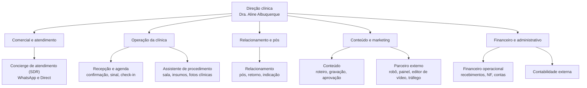
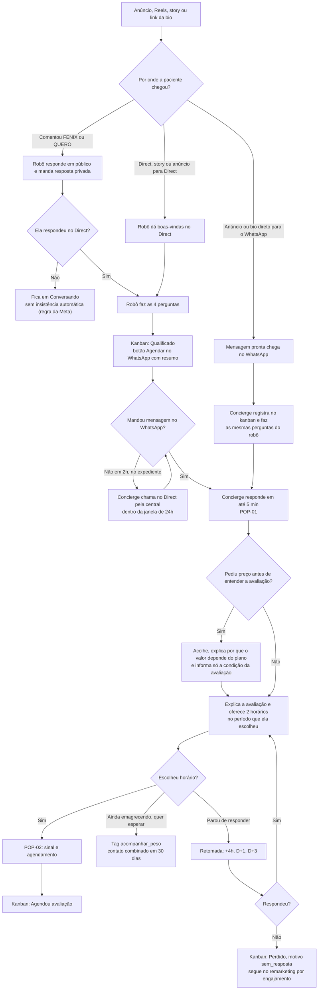
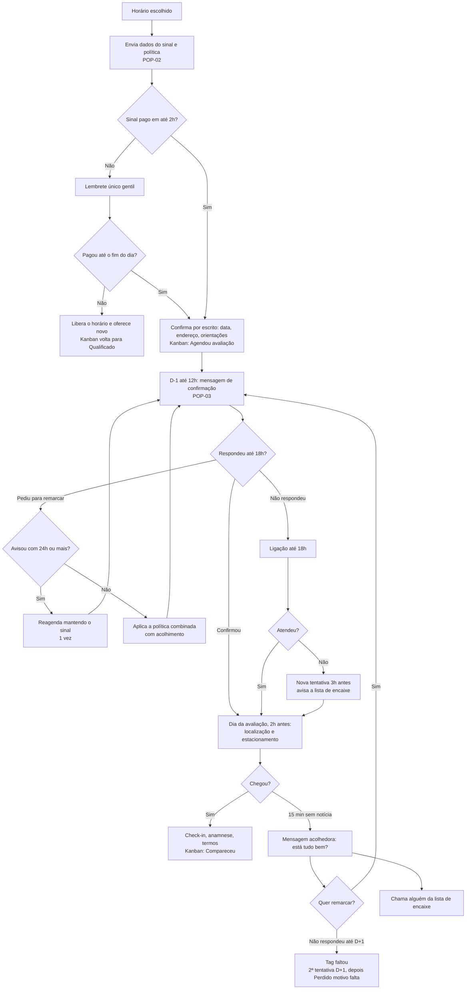
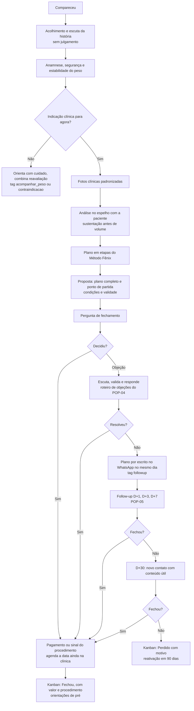
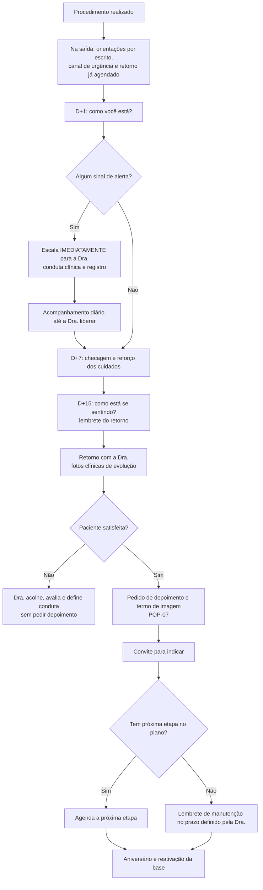

# Estratégia da Clínica: Dra. Aline Albuquerque

**Harmonização facial em Santos/SP · nicho: derretimento facial pós-emagrecimento · Método Fênix (facial e corporal)**

Versão 1.0 · 26/11/2026 · documento vivo: cada hipótese confirmada vira fato e perde o rótulo "HIPÓTESE".

> *"O que não está estruturado depende da doutora. O que está estruturado trabalha por ela."*

---

## Como ler este documento

| Se você é... | Leia primeiro |
|---|---|
| Dra. Aline | Resumo executivo, seção 1.5 (perguntas), seção 2.1 (o que é só seu), seção 7 (plano) |
| Quem atende WhatsApp/Direct | POP-01, POP-02, POP-03, POP-05 |
| Recepção / assistente | POP-03, POP-06, POP-07 |
| Equipe de conteúdo e tráfego | POP-07 (legendas), POP-08 |

## Resumo executivo

A Aline já tem o que muita clínica não tem: um nicho claro (quase ninguém em Santos está posicionado em pós-emagrecimento), um método com nome, selo azul, anúncio rodando e um robô que qualifica no Direct. O dinheiro não vaza na captação. **Vaza entre a conversa e a cadeira**: resposta lenta no WhatsApp, avaliação marcada sem sinal e sem confirmação, consulta sem roteiro de proposta e paciente que "vai pensar" e nunca mais é procurada.

Simulação com os benchmarks do estudo de mercado (não são números dela) e 100 conversas por mês, que é o volume estimado para a verba atual:

| Cenário | Conversa → agendou | Agendou → compareceu | Compareceu → fechou | Pacientes fechadas |
|---|---|---|---|---|
| Média do mercado | 32% → 32 | 62% → 20 | 40% → 8 | **8** |
| Faixa "bom" | 40% → 40 | 70% → 28 | 50% → 14 | **14** |

Com o ticket de referência de R$ 3.500 do Método Fênix facial (`config/negocio.json`, HIPÓTESE: confirmar), a diferença entre os dois cenários é de **6 pacientes e cerca de R$ 21.000 por mês com o mesmo investimento em anúncio**. Esse ganho não vem de mais verba: vem de processo.

Três coisas para começar já na semana 1:
1. **Primeira resposta no WhatsApp em até 5 minutos** no expediente, com roteiro (POP-01).
2. **Avaliação só com sinal e confirmada na véspera e 2h antes** (POP-02 e POP-03).
3. **Todo lead registrado no kanban** com a etapa certa, para o painel mostrar onde a paciente se perde.

---

## 1. Diagnóstico

### 1.1 O que já se sabe (fatos)

| Tema | Fato | Fonte |
|---|---|---|
| Posicionamento | "Trato o derretimento facial da perda de peso. Esp. em harmonização para o emagrecimento. Criadora do Método..." | Bio do Instagram |
| Perfil | @dra.alinealbuquerque, cerca de 9,9 mil seguidores, selo azul | Instagram |
| Destaques | Fênix facial, Fênix corporal, Clínica, Localização, Minha História, Feedbacks | Instagram |
| Produtos | Método Fênix facial (prioridade 1), Fênix corporal (2), harmonização facial em geral (3) | `config/negocio.json` |
| Ticket de referência | R$ 3.500 facial, R$ 3.000 corporal, R$ 2.500 outros (estimativa de configuração, não medido) | `config/negocio.json` |
| Público | Mulheres de 30 a 60 anos que emagreceram rápido (dieta, bariátrica, canetas) na Baixada Santista | `config/negocio.json` |
| Tráfego | Campanha já rodando; verba de referência R$ 1.800/mês; meta de custo por conversa R$ 18 | `CLAUDE.md`, `negocio.json` |
| Atendimento | Link wa.me/5513988171698 na bio, com mensagem pronta | Instagram |
| Robô do Instagram | Comentário FENIX/QUERO, Direct com palavra-chave, anúncio para Direct, story: 4 perguntas e botão para o WhatsApp com resumo | `config/automacoes.json` |
| Expediente do robô | Segunda a sábado, 9h às 19h; fora disso avisa e continua qualificando | `config/automacoes.json` |
| Funil do kanban | Novo → Conversando → Qualificado → Agendou avaliação → Compareceu → Fechou / Perdido | `config/marca.json` |
| Concorrência local | Nenhum concorrente posicionado em pós-emagrecimento encontrado em Santos (falta conferir logado na Biblioteca de Anúncios) | `docs/ESTUDO_DE_MERCADO.md` |

### 1.2 O que as ferramentas do projeto já fazem (e onde termina cada uma)

| Ferramenta | O que faz por ela | Onde para (e o processo humano começa) |
|---|---|---|
| **Robô de atendimento + kanban** (`atendimento/`) | Responde comentário em público, chama no Direct, faz as 4 perguntas, entrega o botão do WhatsApp com resumo e move para "Qualificado" | Não conversa no WhatsApp. Do "Qualificado" em diante, a etapa no kanban **só anda se alguém mover** (com valor e procedimento quando fecha) |
| **Painel** (`painel/`) | Vídeo campeão, funil até paciente, horários, público, comparação com o mercado, custo por paciente | Só mostra o que foi registrado. Kanban desatualizado = painel mentiroso |
| **Editor de vídeo** (`video/`) | Do take cru ao Reels com legenda, marca, registro profissional, aviso legal e 3 ganchos para teste A/B | Não escreve o roteiro sozinho (skill `/roteiro-video`) nem aprova o conteúdo |
| **Gestor de tráfego** (`trafego/`, agente `gestor-trafego`) | Auditoria, relatório, criação pausada, corte e escala com regra | Ligar, pausar e mudar verba só com OK explícito |

**Lacuna importante:** o lead que vem do anúncio **direto para o WhatsApp** não passa pelo robô e não aparece no kanban (a central ainda não lê o WhatsApp; o banco já prevê o canal). Até a integração sair, o registro é manual (POP-01, passo 12) e as etiquetas do WhatsApp Business usam exatamente os mesmos nomes das etapas do funil.

**Ajuste no robô (texto), já aplicado em 26/11:** a mensagem do comentário FENIX dizia que o método foi criado "para devolver sustentação e contorno". "Devolver" soa como promessa. Agora diz: *"O Método Fênix é uma avaliação em etapas para planejar a sustentação e o contorno do rosto que mudou com o emagrecimento."*

### 1.3 Hipóteses de trabalho

Tudo abaixo orienta este documento até a Aline responder as perguntas da seção 1.5.

| # | Hipótese | Por que importa |
|---|---|---|
| H1 | **HIPÓTESE: confirmar.** A clínica é enxuta: a Aline e no máximo 1 pessoa de apoio (secretária ou assistente), talvez em meio período. | Define quem acumula cada função (seção 2.3) |
| H2 | **HIPÓTESE: confirmar.** Quem responde o WhatsApp hoje é a própria Aline, entre um atendimento e outro, e à noite. | Primeira resposta lenta é a maior causa de perda nessa etapa |
| H3 | **HIPÓTESE: confirmar.** Não há sinal para reservar a avaliação e a confirmação é feita quando dá. | Sem sinal e sem confirmação o comparecimento tende a ficar na média (60–65%) ou abaixo |
| H4 | **HIPÓTESE: confirmar.** A avaliação dura de 40 a 60 minutos e é feita pela Aline do começo ao fim, incluindo a conversa de valor. | Define o roteiro do POP-04 e quando entra uma pessoa de apoio na proposta |
| H5 | **HIPÓTESE: confirmar.** O Método Fênix é apresentado em etapas (ex.: sustentação → qualidade de pele → refinamento → manutenção). As etapas reais precisam vir dela. | O plano em etapas é a espinha da proposta e do conteúdo |
| H6 | **HIPÓTESE: confirmar.** Não existe follow-up estruturado de quem avaliou e não fechou. | É a receita mais barata da clínica: a paciente já veio, já confia |
| H7 | **HIPÓTESE: confirmar.** O pós-procedimento depende da paciente chamar; não há D+1/D+7/D+15 nem retorno agendado na saída. | Pós fraco = menos indicação, menos depoimento e mais risco clínico passar despercebido |
| H8 | **HIPÓTESE: confirmar.** O termo de uso de imagem não é padronizado e as legendas do conselho nem sempre aparecem. | Risco de processo ético e de anúncio reprovado |
| H9 | **HIPÓTESE: confirmar.** A Aline grava sozinha e de forma irregular; a edição e o tráfego ficam com a equipe externa (Casal da IA). | Define o POP-08 e a divisão de tarefas do conteúdo |
| H10 | **HIPÓTESE: confirmar.** Conselho profissional ainda não definido neste projeto (CRBM, CRO ou CRM). | Muda o que pode ir para conteúdo, as legendas e se o preço da consulta pode ser divulgado |

### 1.4 Onde provavelmente vaza dinheiro (em ordem)

1. **Conversa → agendamento:** demora na primeira resposta, preço jogado sem contexto ou recusado sem acolhimento, lead que some e ninguém retoma.
2. **Agendou → compareceu:** sem sinal, sem confirmação, sem localização, sem lista de encaixe para o horário que vagou.
3. **Compareceu → fechou:** consulta excelente tecnicamente, mas sem plano em etapas por escrito, sem pergunta de fechamento e sem follow-up.
4. **Depois do procedimento:** paciente satisfeita que ninguém pediu para indicar, depor ou voltar para a próxima etapa.

### 1.5 Perguntas para a Aline (as 12 que mais mudam a estrutura)

1. **Qual é o seu conselho e o número do registro** (biomédica/CRBM, dentista/CRO ou médica/CRM)? Muda o que podemos mostrar, as legendas e se o valor da consulta pode aparecer em conteúdo.
2. **Quem trabalha com você hoje, em qual horário, e quem responde o WhatsApp e o Direct**, inclusive à noite e no fim de semana?
3. **Quantas conversas novas chegam por semana e quantas avaliações você faz por semana?** (Pode ser aproximado.)
4. **A avaliação hoje é gratuita, paga ou abatida no tratamento? Você cobra sinal? Quantas pessoas faltam**, mais ou menos, a cada 10 agendadas?
5. **Quais são as etapas reais do Método Fênix** (nomes, ordem, intervalo entre elas) e quanto tempo dura a sua avaliação?
6. **Como você apresenta o valor hoje:** plano completo, por etapa, à vista com condição, cartão em quantas vezes?
7. **Qual é o ticket médio real e quantas pacientes novas você consegue atender por mês** sem perder qualidade (capacidade da agenda)?
8. **Consultório próprio ou sala alugada? Endereço, dias e horários** em que você atende?
9. **Existe algum acompanhamento depois do procedimento** (mensagem, revisão, retorno)? Quem faz e quando?
10. **Você já colhe termo de uso de imagem?** As fotos de pacientes ficam onde (celular pessoal, nuvem, prontuário)?
11. **Quem grava e quem edita os seus vídeos hoje, e quantas horas por semana você consegue reservar para gravar?**
12. **O que você faz hoje que mais te cansa e gostaria de largar primeiro?**

---

## 2. Organograma por função

### 2.1 Doutora x operação

| Só a Dra. Aline faz | Delegável (pessoa treinada com POP) | Automatizável (ferramenta do projeto) |
|---|---|---|
| Avaliação clínica e diagnóstico | Primeira resposta e qualificação no WhatsApp | Resposta a comentário e Direct, 4 perguntas, botão do WhatsApp (robô) |
| Plano de tratamento do Método Fênix | Agendamento, sinal, confirmação, reagendamento | Etapas Novo → Qualificado e tags (robô/kanban) |
| Procedimento | Apresentação do investimento e condições (depois de treinada) | Funil, custo por paciente, vídeo campeão (painel) |
| Conduta em intercorrência | Follow-up de quem não fechou | Legenda, marca, aviso legal e 3 ganchos (editor de vídeo) |
| Rosto da marca: gravar e aparecer | Pós D+1/D+7/D+15, retorno, aniversário | Auditoria e regras de corte e escala (gestor de tráfego) |
| Aprovação final de conteúdo e de qualquer imagem de paciente | Pedido de depoimento, indicação, termo de imagem | Relatório semanal (`painel/gerar_painel.py --resumo`) |
| Política de preço e condições | Financeiro operacional (recebimento, conciliação, NF) | |

### 2.2 Desenho do organograma (por função)

### 2.3 Quem acumula o quê (e como a clínica cresce)

| Função | Fase A: 1 a 2 pessoas | Fase B: 3 pessoas | Fase C: 5 a 6 pessoas |
|---|---|---|---|
| Direção clínica | Aline | Aline | Aline (e, se fizer sentido, 2ª profissional executora) |
| Concierge de atendimento (SDR) | **Secretária-concierge** (se não houver, Aline + robô) | Concierge comercial | Concierge comercial dedicada |
| Recepção e agenda | Secretária-concierge | Recepcionista-assistente | Recepcionista |
| Assistência de procedimento | Secretária-concierge nos horários de procedimento (ou Aline sozinha) | Recepcionista-assistente | Assistente de procedimento |
| Relacionamento e pós | Secretária-concierge, com mensagens prontas | Concierge comercial (pós remoto) | Relacionamento/CS (pode somar com o financeiro) |
| Conteúdo | Aline grava; equipe externa edita e sobe | Aline grava; concierge organiza pauta e banco de takes | Social media meio período ou freelancer |
| Tráfego, painel, robô | Equipe externa (Casal da IA) | Equipe externa | Equipe externa |
| Financeiro operacional | Secretária-concierge + contabilidade; Aline aprova | Recepcionista-assistente + contabilidade | Administrativo/financeiro meio período ou BPO |

**Gatilhos para contratar (regras, não números dela):**
- Primeira resposta média acima de 15 minutos no expediente por 2 semanas seguidas → a função de concierge precisa de uma pessoa dedicada.
- Agenda de avaliações com mais de 80% de ocupação por 4 semanas → abrir mais horários ou contratar assistente para liberar a Aline da parte não clínica.
- Pós e follow-up atrasando (mensagens do dia não enviadas em mais de 2 dias da semana) → separar relacionamento do comercial.
- Aline gastando mais de 3 horas por semana com conteúdo fora da gravação → social media.

Na **Fase A**, a "secretária-concierge" é o cargo mais importante da clínica depois da Aline. Se só der para contratar uma pessoa, é ela.

### 2.4 Descrição de cargos

#### Direção clínica: Dra. Aline Albuquerque
- **Missão:** garantir resultado clínico seguro e ético, conduzir a avaliação que converte e ser o rosto da marca.
- **Responsabilidades:**
  - Avaliação do Método Fênix (POP-04), plano de tratamento e procedimento.
  - Conduta em qualquer intercorrência ou dúvida clínica.
  - Gravação semanal (bloco fixo na agenda) e aprovação final de todo conteúdo e de toda imagem de paciente.
  - Definir política de preço, condições, sinal e regras de reagendamento.
  - Rotina de gestão: 10 minutos por dia, 30 por semana, 1 hora por mês (seção 6.2).
- **Reporta a:** ninguém. Decide com base no painel.
- **KPIs:** compareceu → fechou; ticket médio; % de pacientes com próxima etapa agendada; satisfação (NPS); gravações feitas na semana.
- **O que NÃO é dela:** responder primeiro contato no WhatsApp, confirmar consulta, cobrar sinal, mandar mensagem de pós de rotina, editar vídeo, mexer em campanha.

#### Concierge de atendimento (SDR)
- **Missão:** transformar conversa em avaliação agendada, com sinal pago, sem perder ninguém por demora.
- **Responsabilidades:**
  - Primeira resposta em até 5 minutos no expediente (POP-01), usando o resumo do robô.
  - Qualificar quem chegou direto pelo WhatsApp com as mesmas perguntas do robô.
  - Agendar com sinal (POP-02) e registrar no kanban.
  - Retomar quem parou de responder antes de agendar.
  - Follow-up de quem avaliou e não fechou (POP-05), na Fase A e B.
- **Reporta a:** Dra. Aline.
- **KPIs:** tempo de primeira resposta; % conversa → agendamento; % de agendamentos com sinal; leads sem resposta há mais de 24h (meta zero).
- **O que NÃO é dela:** dar opinião clínica ("no seu caso precisa de X"), prometer resultado, passar preço de tratamento antes da avaliação, citar nome de produto ou remédio.

#### Recepção e agenda
- **Missão:** fazer a paciente agendada chegar, no horário, acolhida e com tudo pronto.
- **Responsabilidades:**
  - Confirmação D-1 e 2 horas antes (POP-03), localização e orientações.
  - Reagendamento e lista de encaixe.
  - Check-in: ficha de anamnese, termos, água/chá, tempo de espera abaixo de 10 minutos.
  - Mover no kanban para "Compareceu" no dia.
  - Receber pagamento presencial e emitir recibo/NF (Fase A e B).
- **Reporta a:** Dra. Aline.
- **KPIs:** % agendou → compareceu; taxa de falta; horários vagos recuperados pela lista de encaixe; atraso médio da agenda.
- **O que NÃO é dela:** negociar condição fora da política; dar orientação clínica de pós (só repassa as orientações escritas pela Dra.).

#### Assistente de procedimento
- **Missão:** a Dra. só se preocupa com a paciente: sala, material e registro prontos.
- **Responsabilidades:**
  - Preparar sala, materiais e biossegurança antes de cada atendimento.
  - Fotos clínicas padronizadas (mesma luz, fundo e ângulos) para o prontuário.
  - Controle de insumos e validade; aviso de reposição com antecedência.
  - Entregar orientações de pós por escrito e agendar o retorno antes de a paciente sair.
- **Reporta a:** Dra. Aline.
- **KPIs:** atendimentos sem atraso por preparo; ruptura de insumo (meta zero); % de pacientes que saem com retorno marcado.
- **O que NÃO é dela:** realizar procedimento; publicar ou enviar foto de paciente para qualquer pessoa.

#### Relacionamento e pós
- **Missão:** fazer cada paciente se sentir cuidada depois do procedimento, voltar para a próxima etapa e indicar.
- **Responsabilidades:**
  - Mensagens D+1, D+7, D+15 e convite para o retorno (POP-06).
  - Escalar para a Dra. na hora qualquer sinal de alerta.
  - Pedido de depoimento, termo de imagem e indicação (POP-07).
  - Lembretes de manutenção e aniversário.
- **Reporta a:** Dra. Aline.
- **KPIs:** % de retornos no prazo; NPS; depoimentos com termo por mês; indicações por mês; % de pacientes que seguem para a etapa seguinte.
- **O que NÃO é dela:** avaliar foto clínica ou dizer se "está normal"; pedir depoimento a quem está insatisfeita.

#### Conteúdo e marketing (interno + parceiro externo)
- **Missão:** manter o Instagram e o anúncio alimentados com vídeos da Aline que geram conversa qualificada, dentro das regras.
- **Responsabilidades (interno):** pauta da semana, organizar o bloco de gravação, roteiro com a skill `/roteiro-video`, checklist de regras antes da aprovação.
- **Responsabilidades (parceiro externo):** editar no editor de vídeo com 3 ganchos, subir no conjunto de teste, auditoria e relatório de tráfego, manter robô e painel.
- **Reporta a:** Dra. Aline.
- **KPIs:** Reels publicados por semana; criativos novos por semana; taxa de gancho; custo por conversa; custo por paciente.
- **O que NÃO é dele:** publicar sem aprovação da Dra.; usar imagem de paciente sem termo; mexer em verba sem OK.

#### Financeiro e administrativo
- **Missão:** saber, todo mês, quanto entrou, quanto saiu e quanto custou cada paciente.
- **Responsabilidades:**
  - Conciliar sinais e pagamentos com a agenda (sinal pago = avaliação real).
  - Emitir NF/recibo, controlar recebíveis do cartão.
  - Contas a pagar (insumos, aluguel, anúncio, ferramentas).
  - Fechamento mensal simples: faturamento, custos, custo por paciente, ticket médio.
- **Reporta a:** Dra. Aline. Contabilidade externa faz a parte fiscal.
- **KPIs:** fechamento entregue até o dia 5; divergência entre kanban e caixa (meta zero); inadimplência.
- **O que NÃO é dele:** dar desconto; mudar condição de pagamento combinada pela Dra.

---

## 3. Mapa de processos por prioridade

Prioridade 1 é o que vaza dinheiro hoje. Prioridade 2 multiplica o que entra. Prioridade 3 sustenta.

| Prior. | Processo | Vazamento que fecha | Dono | Ferramenta | POP |
|---|---|---|---|---|---|
| 1 | Primeira resposta e qualificação | Lead que esfria esperando resposta | Concierge | Robô + kanban, WhatsApp Business | POP-01 |
| 1 | Agendamento com sinal | Agenda "de mentira" | Concierge | Agenda, Pix, kanban | POP-02 |
| 1 | Confirmação, reagendamento e falta | Cadeira vazia | Recepção | WhatsApp, lista de encaixe | POP-03 |
| 1 | Consulta de avaliação Método Fênix e proposta | Paciente que gostou e não fechou | Dra. Aline | Plano por escrito, kanban | POP-04 |
| 1 | Follow-up de quem não fechou | Receita que já estava na mão | Concierge | Kanban (tag `followup`) | POP-05 |
| 2 | Pré-procedimento | Remarcação e desistência às vésperas | Recepção | Mensagem padrão | (dentro do POP-02/04) |
| 2 | Pós-procedimento e retorno | Paciente que não volta para a etapa 2 | Relacionamento | Agenda, mensagens | POP-06 |
| 2 | Depoimento, termo de imagem e indicação | Prova social travada, indicação perdida | Relacionamento | Termo, robô (tag `embaixadora`) | POP-07 |
| 2 | Produção semanal de conteúdo | Anúncio cansado, custo por conversa subindo | Aline + conteúdo + parceiro | Editor de vídeo, gestor de tráfego, painel | POP-08 |
| 3 | Intercorrência e reclamação | Risco clínico e de reputação | Dra. Aline | Canal de urgência | (POP-06, exceções) |
| 3 | Financeiro mensal | Não saber o custo por paciente | Financeiro | Painel + caixa | (onda do mês 2) |
| 3 | Insumos e estoque | Procedimento remarcado por falta de material | Assistente | Planilha de estoque | (onda do mês 2) |
| 3 | Aniversário e reativação da base | Base parada | Relacionamento | Lista de pacientes | (onda do mês 2) |

---

## 4. Fluxogramas dos processos prioritários

### 4(a) Captação → conversa → avaliação agendada

**Gargalos atuais (hipótese):** resposta no WhatsApp fora dos 5 minutos; lead do WhatsApp direto sem registro; preço jogado ou recusado de forma seca; ninguém retoma quem parou de responder.

### 4(b) Agendada → compareceu

**Gargalos atuais (hipótese):** avaliação sem compromisso financeiro; confirmação feita só quando sobra tempo; horário que vaga não é preenchido.

### 4(c) Avaliação Método Fênix → fechamento → follow-up

**Gargalos atuais (hipótese):** plano explicado só de boca; ninguém pergunta "vamos começar?"; "vou pensar" sem data de retorno; nenhum registro do motivo da perda.

### 4(d) Procedimento → pós → retorno → indicação

**Gargalos atuais (hipótese):** paciente sai sem retorno marcado; pós só quando ela chama; depoimento pedido de improviso (ou nunca); indicação deixada ao acaso.

---

## 5. POPs das tarefas críticas

### Linguagem da clínica (vale para todos os POPs)

A paciente deste nicho chega sensível: emagreceu, muitas vezes depois de anos de luta, e não se reconhece no espelho. A primeira coisa que ela precisa sentir é que **não vai ser julgada**.

| Evite | Prefira |
|---|---|
| "Seu rosto caiu", "derreteu", "ficou flácida", "envelhecido" | "O rosto mudou com o emagrecimento", "perdeu sustentação", "o contorno mudou" |
| Comentar peso, corpo ou forma de emagrecer | Parabenizar a conquista só se ela trouxer o assunto, sem opinar sobre o método |
| Nome de remédio, de caneta ou de produto | "Emagrecimento rápido", "canetas emagrecedoras" (se ela citar), "procedimentos reconhecidos" |
| "Vai ficar perfeita", "vai rejuvenescer", "resultado garantido" | "A Dra. vai te mostrar o que faz sentido para o seu rosto" |
| "Promoção", "pacote", "só hoje" | "Condição", "plano", "forma de pagamento" |
| "Você precisa de..." (dito por quem não é a Dra.) | "Quem define o plano é a Dra., na avaliação" |

Dica: "derretimento facial" é o termo da marca, bom para conteúdo. No um a um, deixe a paciente usar as palavras dela e repita as palavras dela.

---

### POP Nº 01 — Primeira resposta e qualificação no WhatsApp e no Direct

**1. OBJETIVO**
Responder toda nova conversa em até 5 minutos no expediente, acolher, entender o caso com as mesmas perguntas do robô e levar a paciente à avaliação, sem preço de tratamento e sem promessa.

**2. ÁREA / RESPONSÁVEL**
Comercial. Concierge de atendimento (Fase A: secretária-concierge; sem ela, a Dra. com o robô fazendo a triagem).

**3. QUANDO EXECUTAR (gatilho)**
- Notificação de lead "Qualificado" na central (veio do robô com resumo).
- Nova mensagem no WhatsApp de número que não é paciente.
- Lead em "Conversando" na central que não clicou no WhatsApp em 2 horas.

**4. PRÉ-REQUISITOS**
- WhatsApp Business com etiquetas iguais às etapas do funil: Novo, Conversando, Qualificado, Agendou avaliação, Compareceu, Fechou, Perdido.
- Acesso à central de atendimento (tela web) e às respostas rápidas cadastradas.
- Agenda de avaliações da semana aberta, com os horários livres por período.
- Condição da avaliação definida pela Dra. (gratuita com sinal, paga ou abatida) — HIPÓTESE: confirmar.
- Mensagem de ausência do WhatsApp Business ligada fora do expediente.

**5. PASSO A PASSO**
1. Abra a conversa em até 5 minutos.
2. Leia o resumo do robô (incômodo, quanto emagreceu, se já fez harmonização, período preferido). Se veio direto pelo WhatsApp, não há resumo: use a mensagem M1-B.
3. Cumprimente pelo primeiro nome e se apresente pelo seu nome (M1-A ou M1-B).
4. Repita, com as palavras dela, o que mais incomoda. Não acrescente diagnóstico.
5. Se faltar alguma das 4 informações, pergunte uma de cada vez.
6. Explique a avaliação (M2): quem faz, quanto dura, o que ela leva para casa.
7. Se ela perguntar preço, use M3. Se insistir, use M3-B. Nunca mande tabela.
8. Ofereça 2 horários do período que ela escolheu (M4). Nunca pergunte "quando você pode?".
9. Escolheu horário: siga o POP-02.
10. Disse que ainda está emagrecendo e quer esperar: use M6, aplique a tag `acompanhar_peso` e anote a data de retorno.
11. Parou de responder: retome com M5 em +4h, D+1 e D+3. Sem resposta depois disso: mova para Perdido com a tag `sem_resposta`.
12. Lead que veio direto pelo WhatsApp: registre no kanban (nome, origem "anúncio WhatsApp" ou "bio") e mantenha a etiqueta do WhatsApp Business igual à etapa do kanban.
13. Antes de sair do expediente, zere a lista de conversas sem resposta.

**6. PADRÃO DE QUALIDADE (checklist)**
- [ ] Primeira resposta em até 5 minutos no expediente.
- [ ] Chamou pelo nome e se apresentou.
- [ ] Repetiu o incômodo com as palavras dela.
- [ ] Nenhum preço de tratamento no primeiro contato.
- [ ] Ofereceu 2 horários concretos.
- [ ] Etapa e tag certas no kanban e no WhatsApp Business.
- [ ] Mensagens curtas (até 4 linhas), sem áudio longo, sem emoji em excesso.

**7. O QUE NÃO FAZER**
- Não dizer o que ela "precisa fazer" nem citar procedimento ou produto.
- Não prometer resultado nem tempo de duração.
- Não comentar peso, corpo ou forma de emagrecimento.
- Não mandar áudio de mais de 30 segundos no primeiro contato.
- Não mandar mais de 3 retomadas para quem não responde.
- Não pedir foto do rosto para "avaliar pelo WhatsApp". Se ela mandar, agradeça e diga que a Dra. analisa na avaliação.

**8. EM CASO DE EXCEÇÃO**
- **Já é paciente:** direcione para Relacionamento (POP-06) e avise a Dra. se for queixa.
- **Pergunta clínica** ("posso fazer se estou usando X?", "tenho doença Y"): "Ótima pergunta, essa resposta precisa ser da Dra. Aline. Vou anotar para ela ver na sua avaliação." Se for urgente ou parecer complicação de outro profissional, avise a Dra. no mesmo dia.
- **Menor de 18 anos:** agradeça e encerre com cuidado; não agende.
- **Reclamação pública em comentário:** não discuta em público. Chame no Direct e avise a Dra.
- **Fora do expediente:** o robô e a mensagem de ausência seguram; responda na primeira hora do dia seguinte, começando pelos mais antigos.

**9. FERRAMENTAS / MODELOS**
Ferramentas: central de atendimento e kanban (`atendimento/`), respostas rápidas da central ("Avaliação", "Valores", "Horários", "Endereço"), WhatsApp Business com etiquetas, agenda.

**M1-A — Abertura (veio do robô, com resumo)**
> Oi, [nome]! Aqui é a [seu nome], da equipe da Dra. Aline. Recebi suas respostas lá do Instagram, obrigada por contar um pouquinho da sua história.
> Você comentou que o que mais te incomoda hoje é [incômodo, com as palavras dela]. É exatamente isso que a Dra. Aline olha com calma na avaliação do Método Fênix.
> Posso te explicar rapidinho como funciona?

**M1-B — Abertura (chegou direto no WhatsApp)**
> Oi, [nome]! Que bom que você chamou. Aqui é a [seu nome], da equipe da Dra. Aline, em Santos.
> Para eu te orientar direitinho, posso te fazer 3 perguntinhas rápidas?

Perguntas, uma por vez:
> 1. O que mais te incomoda hoje no seu rosto?
> 2. Você passou por um emagrecimento recente? Se quiser contar, mais ou menos quanto e em quanto tempo.
> 3. Já fez algum procedimento de harmonização antes?
> (E depois:) Qual período fica melhor para você: manhã, tarde, noite ou sábado?

**M2 — Como é a avaliação**
> A avaliação é o primeiro passo, e é feita pela própria Dra. Aline. Ela escuta a sua história, analisa o seu rosto com calma, te mostra no espelho onde houve perda de sustentação e monta um plano em etapas só para você.
> Você sai de lá entendendo o que faz sentido para o seu caso, sem compromisso de fazer nada no mesmo dia.

**M3 — Perguntou o preço**
> Entendo totalmente querer saber o investimento. O valor do tratamento depende do plano que a Dra. monta, porque cada rosto muda de um jeito depois do emagrecimento, e eu não quero te passar um número que não tenha a ver com o seu caso.
> O que já posso te dizer é como funciona a avaliação: [condição definida pela Dra.: ex. "o valor é R$ ___ e é abatido do tratamento se você seguir"]. Quer que eu veja os horários para você?

**M3-B — Insistiu no preço**
> Claro, sem problema. Os planos variam conforme as etapas que cada rosto precisa, e na avaliação a Dra. te mostra o valor exato e as formas de pagamento, por escrito, para você decidir com calma.
> [Só se a Dra. autorizar uma faixa: "Para você ter uma referência, os planos do Método Fênix costumam partir de R$ ___."]
> Posso reservar um horário para você conhecer o plano?

**M4 — Oferecer horários**
> A Dra. tem estes horários [no período que ela escolheu]: [dia] às [hora] ou [dia] às [hora]. Qual fica melhor para você?

**M5 — Retomada (parou de responder)**
- +4h: "Oi, [nome]! Consegui segurar o horário de [dia] às [hora] até o fim do dia para você. Quer que eu confirme?"
- D+1: "Oi, [nome], tudo bem? Fiquei pensando em você. Se ficou alguma dúvida sobre a avaliação, pode me perguntar, estou aqui."
- D+3: "Oi, [nome]! Não quero te encher de mensagem. Vou deixar a conversa aberta: quando for o seu momento, é só me chamar aqui que eu vejo os horários da Dra. para você."

**M6 — Ainda emagrecendo, quer esperar**
> Faz todo sentido pensar nisso. Essa é uma das dúvidas mais comuns de quem está emagrecendo, e quem define o melhor momento é a Dra., olhando o seu rosto e o seu processo.
> Se quiser, a avaliação já serve para você entender o que pode ser feito agora e o que vale esperar. Ou, se preferir, combino de te chamar daqui a 30 dias. O que fica melhor para você?

**Mensagem de ausência do WhatsApp Business (fora do expediente)**
> Oi! Aqui é da equipe da Dra. Aline. Recebemos a sua mensagem e respondemos pessoalmente de segunda a sábado, das 9h às 19h. Se quiser, já me conta o que mais te incomoda hoje no seu rosto, que eu respondo assim que abrir.

**10. VERSÃO / DATA**
v1.0 · 26/11/2026 · Revisar quando a Dra. definir a condição da avaliação (pergunta 4) e quando o WhatsApp for integrado à central.

---

### POP Nº 02 — Agendamento da avaliação com sinal

**1. OBJETIVO**
Transformar o "sim" em horário reservado com sinal pago, dados completos e política combinada por escrito, para a agenda ser real.

**2. ÁREA / RESPONSÁVEL**
Comercial. Concierge de atendimento.

**3. QUANDO EXECUTAR (gatilho)**
A paciente escolheu um dos horários oferecidos (POP-01, passo 9).

**4. PRÉ-REQUISITOS**
- Valor do sinal e política de reagendamento definidos pela Dra. (HIPÓTESE: confirmar. Sugestão: sinal com valor da avaliação, abatido no tratamento; reagendamento com 24h ou mais mantém o sinal uma vez; falta sem aviso não devolve o sinal).
- Chave Pix da clínica (de preferência CNPJ) e nome do favorecido.
- Agenda com o horário bloqueado provisoriamente.

**5. PASSO A PASSO**
1. Bloqueie o horário na agenda como "provisório" por 2 horas.
2. Peça nome completo e data de nascimento (confirma maioridade e serve para a ficha).
3. Envie a mensagem M7 com valor do sinal, chave Pix e política.
4. Ao receber o comprovante, confira valor e favorecido.
5. Troque o horário de "provisório" para "confirmado" na agenda.
6. Mova a paciente para "Agendou avaliação" no kanban e na etiqueta do WhatsApp.
7. Envie a mensagem M8 com data, endereço, orientações e o pedido opcional da foto antiga.
8. Registre o sinal na planilha de recebimentos (data, nome, valor, horário).
9. Sem comprovante em 2 horas: envie o lembrete M9, uma vez só.
10. Sem pagamento até o fim do dia: libere o horário, envie M10 e volte a paciente para "Qualificado".

**6. PADRÃO DE QUALIDADE (checklist)**
- [ ] Política de reagendamento enviada por escrito antes do pagamento.
- [ ] Comprovante conferido.
- [ ] Agenda, kanban e WhatsApp com a mesma informação.
- [ ] Endereço e orientações enviados.
- [ ] Sinal lançado na planilha.

**7. O QUE NÃO FAZER**
- Não segurar horário sem sinal por mais de um dia.
- Não "esquecer" a política para agradar: regra igual para todas evita constrangimento depois.
- Não pedir dados de cartão por mensagem.
- Não cobrar sinal sem explicar que ele é abatido (se for o caso).

**8. EM CASO DE EXCEÇÃO**
- **Paciente indicada ou que já é da clínica:** a Dra. decide se dispensa o sinal; registre a exceção.
- **Pediu para pagar no dia:** ofereça uma vez a explicação de por que o sinal existe (M7). Se recusar, a Dra. decide.
- **Pix caiu em nome de terceiro:** aceite e anote o nome do pagador.
- **Paciente quer o horário de outra pessoa:** coloque na lista de encaixe.

**9. FERRAMENTAS / MODELOS**
Ferramentas: agenda, Pix, kanban da central, planilha de recebimentos.

**M7 — Sinal e política**
> Perfeito, [nome]! Deixei [dia] às [hora] reservado para você.
> Para confirmar, a gente trabalha com um sinal de R$ [valor], que [é abatido do seu tratamento / corresponde à avaliação]. É ele que garante que esse horário fique só seu.
> Pix: [chave] — [favorecido]. É só me mandar o comprovante por aqui.
> Se precisar remarcar, me avisa com pelo menos 24h de antecedência que o sinal continua valendo para a nova data.

**M8 — Confirmado**
> Agendado, [nome]! Sua avaliação com a Dra. Aline é [dia], [data], às [hora].
> Endereço: [endereço completo]. [Referência / estacionamento.]
> Algumas orientações para aproveitar melhor:
> - Se puder, venha com pouca ou nenhuma maquiagem, para a Dra. analisar bem a pele.
> - A avaliação leva cerca de [XX] minutos. Venha sem pressa.
> - Se você se sentir à vontade, traga no celular uma foto sua de antes do emagrecimento. Ajuda a Dra. a entender o que mudou. É totalmente opcional.
> Na véspera eu te mando uma mensagem para confirmar. Qualquer coisa, estou por aqui.

**M9 — Lembrete do sinal (uma vez)**
> [Nome], passando só para lembrar que estou segurando o seu horário de [dia] às [hora] até o fim do dia. Se preferir outra data, me fala que eu ajusto.

**M10 — Horário liberado**
> [Nome], como não consegui confirmar, liberei o horário de [dia] para não prender a agenda da Dra. Assim que quiser, me chama que eu vejo os próximos horários para você.

**10. VERSÃO / DATA**
v1.0 · 26/11/2026 · Revisar com a política definida pela Dra. (pergunta 4).

---

### POP Nº 03 — Confirmação da avaliação, reagendamento e falta

**1. OBJETIVO**
Fazer a paciente agendada chegar. Meta pelo benchmark: comparecimento acima de 70%.

**2. ÁREA / RESPONSÁVEL**
Recepção e agenda (Fase A: secretária-concierge).

**3. QUANDO EXECUTAR (gatilho)**
- Todo dia útil às 10h: lista das avaliações de amanhã (D-1).
- No dia: 2 horas antes de cada avaliação.
- 15 minutos de atraso sem notícia.

**4. PRÉ-REQUISITOS**
- Agenda do dia seguinte fechada até as 10h.
- Lista de encaixe atualizada (pacientes que pediram horário mais cedo).
- Link de localização do consultório (Google Maps) e informação de estacionamento.

**5. PASSO A PASSO**
1. Às 10h do dia anterior, envie M11 para todas as avaliações do dia seguinte.
2. Marque quem confirmou.
3. Até 18h, ligue para quem não respondeu. Se atender, confirme e anote.
4. Quem pediu para remarcar com 24h ou mais: reagende mantendo o sinal (uma vez) e reinicie este POP.
5. Quem pediu para remarcar com menos de 24h: aplique a política com acolhimento (M14).
6. No dia, 2 horas antes, envie M12 com localização.
7. Quem ainda não confirmou: ligue 3 horas antes e avise a primeira pessoa da lista de encaixe que pode haver vaga.
8. Na chegada: check-in, ficha de anamnese, termo de fotos clínicas, água ou chá. Mova para "Compareceu" no kanban.
9. Com 15 minutos de atraso sem notícia, envie M13.
10. Se não vier: ofereça o horário para a lista de encaixe na hora.
11. Faltou: aplique a tag `faltou`, envie M15 no D+1. Sem resposta: mova para Perdido com a tag `falta`.

**6. PADRÃO DE QUALIDADE (checklist)**
- [ ] 100% das avaliações do dia seguinte receberam a mensagem até 10h30.
- [ ] Ligação feita para todas as não respondidas até 18h.
- [ ] Localização enviada 2h antes.
- [ ] "Compareceu" marcado no kanban no mesmo dia.
- [ ] Vaga de falta oferecida à lista de encaixe.

**7. O QUE NÃO FAZER**
- Não cobrar a paciente atrasada em tom de bronca.
- Não mandar mais de uma mensagem antes da ligação.
- Não cancelar a avaliação de quem não respondeu sem antes ligar.
- Não expor a política como ameaça ("se faltar perde o dinheiro").

**8. EM CASO DE EXCEÇÃO**
- **A Dra. precisa remarcar:** avise a paciente com o máximo de antecedência, peça desculpas, ofereça prioridade de horário e mantenha o sinal.
- **Paciente chega muito atrasada:** a Dra. decide se atende com tempo reduzido ou remarca; nunca encurte a parte da proposta.
- **Paciente relata problema de saúde novo:** remarque e anote para a Dra.

**9. FERRAMENTAS / MODELOS**
Ferramentas: agenda, WhatsApp Business (etiquetas), kanban, lista de encaixe. Na Fase B, avaliar lembrete automático pela agenda.

**M11 — Confirmação D-1**
> Oi, [nome]! Aqui é a [seu nome], da equipe da Dra. Aline. Passando para confirmar sua avaliação amanhã, [dia], às [hora].
> Me responde com **1** para confirmar ou **2** se precisar remarcar.

**M12 — 2 horas antes**
> [Nome], a Dra. Aline te espera hoje às [hora]. Segue a localização: [link do Maps]. [Estacionamento / referência.]
> Se tiver qualquer imprevisto, me avisa por aqui.

**M13 — 15 minutos de atraso**
> Oi, [nome]! Está tudo bem? Estamos te esperando aqui. Se tiver acontecido algum imprevisto, me avisa que a gente encontra um novo horário.

**M14 — Remarcação em cima da hora**
> Entendo, [nome], imprevistos acontecem. Como o aviso foi com menos de 24h, [aplicar a política combinada]. Mas quero muito que você faça sua avaliação: tenho [dia] às [hora] ou [dia] às [hora]. Qual fica melhor?

**M15 — Faltou (D+1)**
> Oi, [nome], senti sua falta ontem. Espero que esteja tudo bem com você. Quando quiser remarcar, é só me chamar aqui que eu vejo os horários da Dra.

**10. VERSÃO / DATA**
v1.0 · 26/11/2026.

---

### POP Nº 04 — Consulta de avaliação do Método Fênix (com proposta e objeções)

**1. OBJETIVO**
Fazer uma avaliação que a paciente sinta como a primeira vez em que alguém entendeu o que aconteceu com o rosto dela, e sair com decisão: plano fechado e data marcada, ou próximo contato combinado. Meta pelo benchmark: comparecimento → fechamento acima de 50%.

**2. ÁREA / RESPONSÁVEL**
Direção clínica: Dra. Aline. Recepção apoia no antes; na Fase B, a concierge pode conduzir a parte de investimento e condições.

**3. QUANDO EXECUTAR (gatilho)**
Paciente fez check-in e está em "Compareceu".

**4. PRÉ-REQUISITOS**
- Resumo da conversa no kanban lido pela Dra. antes de chamar a paciente (incômodo, quanto emagreceu, já fez harmonização).
- Ficha de anamnese preenchida e termo de fotos clínicas assinado.
- Espelho grande, boa luz frontal, fundo neutro para fotos.
- Modelo do plano por escrito (folha ou PDF) com as etapas do Método Fênix — HIPÓTESE: confirmar nomes, ordem e intervalos reais.
- Condições de pagamento definidas (à vista, cartão em X vezes, validade da condição) — HIPÓTESE: confirmar.

**5. PASSO A PASSO**
Duração de referência: 50 a 60 minutos (HIPÓTESE: confirmar).

*Acolhimento (5 min)*
1. Busque a paciente na recepção pelo nome e conduza até a sala.
2. Ofereça água ou chá. Comece sem pressa e sem falar do rosto.

*Escuta da história (10 min)*
3. Pergunte: "Me conta como foi o seu emagrecimento." Deixe ela falar.
4. Pergunte: "Quando você se olha no espelho hoje, o que você sente?"
5. Pergunte: "O que te fez procurar agora?"
6. Pergunte: "Tem alguma coisa que você não quer de jeito nenhum?" (quase sempre: ficar artificial).
7. Anote as palavras exatas dela. Você vai usá-las na proposta.

*Segurança (5 a 10 min)*
8. Revise anamnese: saúde, medicações, alergias, procedimentos anteriores e quando.
9. Pergunte se o peso está estável ou se ela ainda está emagrecendo, e se há acompanhamento médico. Registre clinicamente, sem opinar sobre o método de emagrecimento.
10. Se não houver indicação para agora (contraindicação ou peso ainda em queda importante, a seu critério clínico), explique com cuidado, combine reavaliação e marque a tag correspondente.

*Fotos clínicas (5 min)*
11. Faça as fotos padronizadas (frontal, 45 graus de cada lado, perfil de cada lado), mesma luz e fundo. São para prontuário; uso em divulgação só com o termo do POP-07.

*Análise no espelho (10 a 15 min)*
12. Coloque a paciente de frente para o espelho e peça que ela mostre o que a incomoda.
13. Explique em linguagem simples, por terços do rosto, onde houve perda de sustentação e onde houve perda de volume.
14. Diga a ideia central do método: "Primeiro a gente trabalha a estrutura, depois cuida da pele, e só então refina. Encher sem sustentação é o que deixa artificial."
15. Confira o entendimento: "Faz sentido para você o que estamos vendo?"

*Plano em etapas (10 min)*
16. Apresente as etapas do Método Fênix no papel, na ordem (exemplo a confirmar: Etapa 1 Sustentação; Etapa 2 Qualidade de pele e firmeza; Etapa 3 Refinamento e contorno; Manutenção).
17. Para cada etapa: o que ela busca, quanto tempo leva, intervalo até a próxima. Sem nome de produto, sem promessa de resultado.
18. Alinhe expectativa: "Cada organismo responde de um jeito. Eu acompanho você em cada etapa e ajusto o plano conforme a sua resposta."

*Proposta (5 a 10 min)*
19. Mostre o investimento do plano completo e o do ponto de partida (Etapa 1), lado a lado.
20. Explique as condições: à vista, cartão em X vezes e a validade da condição (HIPÓTESE: confirmar prazo).
21. Faça a pergunta de fechamento: "Faz sentido para você começarmos pela Etapa 1?" E fique em silêncio.
22. Se houver objeção, siga o roteiro de objeções (item 9).

*Fechamento ou próximo passo*
23. Fechou: receba o pagamento ou o sinal do procedimento, agende a data antes de ela sair e entregue as orientações de pré.
24. Mova para "Fechou" no kanban com valor e procedimento.
25. Não fechou: pergunte "O que falta para você se sentir segura para decidir?", combine o dia do próximo contato e mande o plano por escrito no WhatsApp no mesmo dia (M20). Aplique a tag `followup` e siga o POP-05.

**6. PADRÃO DE QUALIDADE (checklist)**
- [ ] Dra. leu o resumo antes de chamar a paciente.
- [ ] Paciente falou mais que a Dra. nos primeiros 15 minutos.
- [ ] Peso e estabilidade registrados sem julgamento.
- [ ] Fotos clínicas padronizadas feitas.
- [ ] Plano em etapas entregue por escrito.
- [ ] Pergunta de fechamento feita.
- [ ] Kanban atualizado no mesmo dia (Fechou com valor ou tag `followup`).
- [ ] Atraso da agenda abaixo de 15 minutos.

**7. O QUE NÃO FAZER**
- Não falar de valor antes de a paciente entender o plano.
- Não comentar o corpo, a forma de emagrecer ou dizer "você deixou chegar nesse ponto".
- Não citar marca de produto nem nome de remédio.
- Não prometer resultado, número de anos a menos ou duração garantida.
- Não pressionar com "só hoje". A validade da condição existe para organizar a agenda, não para assustar.
- Não terminar a consulta sem um próximo passo com data.

**8. EM CASO DE EXCEÇÃO**
- **Expectativa irreal ou sofrimento intenso com a autoimagem:** acolha, alinhe expectativa com honestidade e, se for o caso, não indique o tratamento agora. Registrar o motivo.
- **Contraindicação:** explique, oriente a buscar o profissional adequado quando couber e combine reavaliação.
- **Acompanhante opinando:** inclua a pessoa na explicação do espelho; a decisão continua sendo da paciente.
- **Pediu desconto:** use a resposta da objeção "está caro". Desconto fora da política só a Dra. decide, e nunca na frente da recepção.

**9. FERRAMENTAS / MODELOS**
Ferramentas: kanban da central (resumo do robô, etapa, valor), modelo do plano em etapas, ficha de anamnese, termo de fotos clínicas, protocolo de fotos.

**Roteiro de objeções do nicho**

| Objeção | Resposta (adaptar com as palavras dela) |
|---|---|
| "Tenho medo de ficar artificial." | "Esse é exatamente o motivo de o método começar pela sustentação, e não pelo volume. O que deixa artificial é encher um rosto que perdeu estrutura. Aqui a gente vai em etapas e eu reavalio você em cada uma." |
| "Ainda estou emagrecendo. Faço agora ou espero?" | Resposta clínica da Dra., caso a caso: o que pode ser feito agora com segurança e o que vale esperar a estabilização. Se for esperar, combinar data de reavaliação. |
| "E se eu engordar de novo / perder mais peso?" | "O plano é feito para o seu rosto de hoje e eu acompanho você. Se o seu peso mudar bastante, a gente reavalia e ajusta as próximas etapas." |
| "Vou pensar." | "Claro, é uma decisão importante. Me ajuda a entender: o que ficou de dúvida? É o plano, o momento ou o investimento?" Tratar a dúvida real. Se mantiver, combinar data do contato e enviar o plano por escrito. |
| "Está caro." | "Entendo. Vamos olhar juntas: o plano completo é este, e o ponto de partida é a Etapa 1, que já trata o que mais te incomoda. Você pode começar por ela e seguir no seu ritmo, com as condições de [à vista / cartão em X vezes]." |
| "Vi mais barato em outro lugar." | "Faz sentido comparar. A diferença aqui é o planejamento: eu avalio sustentação antes de volume, para o resultado ser natural para o seu rosto. Comparar só o preço do procedimento pode esconder essa diferença." Sem falar mal de colega. |
| "Preciso falar com meu marido / minha família." | "Claro. Quer que eu te mande o plano por escrito para você mostrar? Se ajudar, ele pode vir no retorno ou eu explico por chamada." |
| "Tenho medo de dor." | Explicar o conforto do procedimento (anestesia, tempo, cuidados) de forma honesta, sem minimizar. |
| "Quanto tempo dura?" | "Depende de cada organismo e de cada etapa. No seu plano eu já deixo previstas as revisões e a manutenção para a gente acompanhar juntas." Sem número garantido. |
| "Já fiz harmonização e não gostei." | "Obrigada por me contar. O que você não gostou?" Escutar, e mostrar como o planejamento em etapas e as reavaliações evitam repetir aquilo. Se houver produto anterior, avaliar clinicamente antes de propor. |

**10. VERSÃO / DATA**
v1.0 · 26/11/2026 · Revisar quando a Dra. confirmar as etapas reais, a duração e as condições (perguntas 5 e 6).

---

### POP Nº 05 — Follow-up de quem avaliou e não fechou

**1. OBJETIVO**
Recuperar a paciente que gostou da avaliação mas não decidiu, sem pressão, com 4 contatos espaçados e com valor em cada um.

**2. ÁREA / RESPONSÁVEL**
Comercial. Concierge de atendimento (a Dra. entra no D+7 se a paciente pedir uma conversa com ela).

**3. QUANDO EXECUTAR (gatilho)**
Paciente em "Compareceu" com a tag `followup`, a partir do dia seguinte à avaliação.

**4. PRÉ-REQUISITOS**
- Plano por escrito já enviado no dia da avaliação (M20).
- Anotação da Dra. com a objeção principal e as palavras da paciente.
- Data do próximo contato combinada na consulta (se houve).
- Conteúdo útil à mão: Reels educativos já publicados (sustentação x volume, o que esperar de cada etapa).

**5. PASSO A PASSO**
1. Todo dia às 11h, filtre no kanban "Compareceu" + tag `followup`.
2. D+1: envie M21 (cuidado e disponibilidade para dúvidas).
3. D+3: envie M22 com um conteúdo útil ligado à objeção dela.
4. D+7: envie M23 oferecendo uma conversa rápida com a Dra. ou o horário da Etapa 1.
5. D+30: envie M24 (reabertura leve).
6. Se ela respondeu e decidiu: agende, mova para "Fechou" com valor e procedimento.
7. Se pediu um prazo ("depois do fim do ano"): respeite e agende o contato na data que ela disse.
8. Se não respondeu depois do D+30: mova para "Perdido" com a tag do motivo (`preco`, `momento`, `medo`, `sem_resposta`, `escolheu_outro`, `familia`).
9. 90 dias depois: uma mensagem de reativação (M25), uma vez só.

**6. PADRÃO DE QUALIDADE (checklist)**
- [ ] Nenhuma paciente com `followup` sem contato agendado.
- [ ] Cada mensagem traz algo útil, não só "e aí, decidiu?".
- [ ] Motivo da perda registrado sempre.
- [ ] No máximo 4 contatos antes de marcar como Perdido.

**7. O QUE NÃO FAZER**
- Não oferecer desconto no follow-up para "forçar" a decisão.
- Não mandar mensagem todo dia.
- Não usar urgência falsa ("últimas vagas").
- Não mandar foto de outra paciente como argumento.

**8. EM CASO DE EXCEÇÃO**
- **Pediu para não receber mais mensagens:** agradeça, pare e registre `nao_contatar`.
- **Fechou com outro profissional:** agradeça, deseje sucesso, registre `escolheu_outro`.
- **Dúvida clínica nova:** encaminhe para a Dra. responder (texto ou áudio curto dela).

**9. FERRAMENTAS / MODELOS**
Ferramentas: kanban (tags e etapa), Reels publicados, plano por escrito. Os motivos de perda alimentam a reunião mensal e o gestor de tráfego (ângulo de conteúdo para cada objeção).

**M20 — Plano por escrito (dia da avaliação)**
> [Nome], foi um prazer te receber hoje. Como combinamos, segue o seu plano do Método Fênix por escrito, com as etapas e as condições, para você olhar com calma. [anexo]
> Qualquer dúvida, pode me perguntar por aqui.

**M21 — D+1**
> Oi, [nome]! A Dra. Aline pediu para eu saber como você ficou depois da avaliação. Surgiu alguma dúvida sobre o plano? Estou aqui para te ajudar.

**M22 — D+3 (com conteúdo ligado à objeção)**
> [Nome], lembrei de você: a Dra. gravou este vídeo explicando [por que começar pela sustentação evita o resultado artificial / o que esperar de cada etapa]. Acho que responde aquela dúvida que você comentou. [link]

**M23 — D+7**
> Oi, [nome]! Se ajudar, a Dra. pode conversar rapidinho com você por chamada para tirar qualquer dúvida. Ou, se já se sentir pronta, tenho [dia] e [dia] para começar a Etapa 1. O que fica melhor?

**M24 — D+30**
> Oi, [nome], tudo bem? Passando só para lembrar que o seu plano continua guardado aqui com a gente. Quando for o seu momento, me chama que eu vejo os horários da Dra.

**M25 — Reativação em 90 dias**
> Oi, [nome]! Faz um tempinho que você esteve com a Dra. Aline. Se quiser, ela pode refazer a sua avaliação para ver como está o seu rosto hoje. Quer que eu veja um horário?

**10. VERSÃO / DATA**
v1.0 · 26/11/2026.

---

### POP Nº 06 — Pós-procedimento (D+1, D+7, D+15 e retorno)

**1. OBJETIVO**
Garantir segurança e cuidado depois do procedimento, detectar cedo qualquer sinal de alerta, levar a paciente ao retorno e à próxima etapa.

**2. ÁREA / RESPONSÁVEL**
Relacionamento e pós (Fase A: secretária-concierge). Toda decisão clínica é da Dra. Aline.

**3. QUANDO EXECUTAR (gatilho)**
Procedimento realizado (paciente em "Fechou" com data de procedimento cumprida).

**4. PRÉ-REQUISITOS**
- Orientações de pós por escrito para cada procedimento, aprovadas pela Dra.
- Lista de sinais de alerta definida pela Dra. (abaixo, sugestão para ela validar).
- Canal de urgência definido (número e horário) — HIPÓTESE: confirmar se é o WhatsApp da clínica com acesso direto da Dra.
- Data do retorno definida pela Dra. (HIPÓTESE: entre 15 e 30 dias, conforme o procedimento).

**5. PASSO A PASSO**
1. Na saída do procedimento: entregue as orientações por escrito, explique o canal de urgência e agende o retorno antes de ela ir embora.
2. D0, à noite: envie M30.
3. D+1: envie M31.
4. Leia a resposta procurando sinais de alerta. Havendo qualquer um, avise a Dra. **imediatamente** (ligação, não só mensagem) e siga a orientação dela.
5. D+7: envie M32.
6. D+15: envie M33 e confirme o retorno.
7. No retorno: a Dra. avalia, faz as fotos clínicas de evolução e define a próxima etapa.
8. Paciente satisfeita: siga o POP-07 no mesmo dia.
9. Agende a próxima etapa do plano antes de ela sair, ou registre a data de manutenção.
10. Cadastre a data de aniversário para a mensagem anual.

**Sinais de alerta (sugestão para a Dra. validar)**
- dor que aumenta em vez de diminuir;
- mudança de cor da pele na região (muito pálida, arroxeada ou manchada);
- bolhas, feridas ou área muito quente e vermelha;
- febre;
- inchaço que piora depois do 3º dia ou assimetria importante e súbita;
- qualquer alteração na visão.

**6. PADRÃO DE QUALIDADE (checklist)**
- [ ] 100% das pacientes saíram com retorno agendado.
- [ ] D+1 enviado até 12h.
- [ ] Todo sinal de alerta escalado em minutos, com registro.
- [ ] Retorno realizado na data.
- [ ] Próxima etapa agendada ou manutenção registrada.

**7. O QUE NÃO FAZER**
- Quem não é a Dra. não diz "isso é normal" diante de sinal de alerta. Escala.
- Não pedir foto de evolução para postar; foto clínica é feita no retorno, para prontuário.
- Não pedir depoimento antes do retorno.
- Não deixar a paciente sem resposta no canal de urgência.

**8. EM CASO DE EXCEÇÃO**
- **Intercorrência:** a Dra. assume, registra no prontuário e define a frequência de acompanhamento. A comunicação com a paciente passa a ser direta com a Dra. até a alta.
- **Paciente insatisfeita com o resultado:** acolha, não discuta, marque com a Dra. Não peça depoimento nem indicação.
- **Paciente não responde no D+1:** nova mensagem à tarde; sem resposta, ligação no D+2.
- **Faltou ao retorno:** reagende com prioridade; o retorno faz parte do tratamento.

**9. FERRAMENTAS / MODELOS**
Ferramentas: agenda, orientações por escrito, kanban (tag `pos` e data do retorno). Na Fase B, avaliar lembrete automático do D+1/D+7/D+15.

**M30 — D0, à noite**
> [Nome], obrigada pela confiança hoje. Lembrando que as orientações estão no papel que você levou [ou: seguem aqui]. Se sentir qualquer coisa diferente, pode chamar neste número, a Dra. Aline acompanha de perto.

**M31 — D+1**
> Bom dia, [nome]! Como você acordou hoje? Me conta como está se sentindo e se está conseguindo seguir os cuidados.

**M32 — D+7**
> Oi, [nome]! Uma semana já. Como você está se sentindo com o seu rosto? Lembrando que o seu retorno com a Dra. está marcado para [data].

**M33 — D+15**
> [Nome], passando para confirmar o seu retorno com a Dra. Aline em [data], às [hora]. É nesse dia que ela vê a sua evolução e combina com você os próximos passos.

**Aniversário**
> Feliz aniversário, [nome]! A Dra. Aline e toda a equipe desejam um ano muito bonito para você. Foi um presente te acompanhar.

**10. VERSÃO / DATA**
v1.0 · 26/11/2026 · A lista de sinais de alerta e os prazos de retorno precisam da validação clínica da Dra.

---

### POP Nº 07 — Depoimento, indicação e termo de uso de imagem

**1. OBJETIVO**
Transformar paciente satisfeita em prova social e em indicação, com consentimento por escrito e dentro das regras do conselho e da Meta.

**2. ÁREA / RESPONSÁVEL**
Relacionamento e pós. A Dra. aprova toda imagem antes de qualquer uso.

**3. QUANDO EXECUTAR (gatilho)**
- No retorno, quando a paciente demonstra satisfação.
- Quando a paciente marca a Dra. em story (o robô aplica a tag `embaixadora` e avisa a equipe).
- Quando ela elogia espontaneamente no WhatsApp ou no Direct.

**4. PRÉ-REQUISITOS**
- Conselho profissional confirmado (define as legendas).
- Modelo do termo de uso de imagem revisado (abaixo, estrutura mínima).
- Pasta protegida da clínica para fotos e termos (nunca no celular pessoal).
- Cartão de indicação (físico ou digital) com o WhatsApp da clínica.

**5. PASSO A PASSO**
1. Confirme que a paciente está satisfeita (pergunte; não presuma).
2. Peça o depoimento com M40, deixando claro que é opcional.
3. Ofereça formatos: texto no WhatsApp, vídeo curto gravado por ela ou avaliação no Google.
4. Para vídeo: oriente com M41 (falar da experiência e do sentimento, sem números e sem promessa).
5. Se a imagem dela for usada em qualquer divulgação, colha o termo de uso de imagem antes, assinado.
6. Guarde o termo e as imagens na pasta protegida, com nome e data.
7. Envie o material para a Dra. aprovar e para a equipe de conteúdo com a etiqueta "termo ok".
8. Na publicação, aplique as legendas obrigatórias do conselho e use o editor de vídeo com `--aviso`.
9. Convide para indicar com M42 e entregue o cartão de indicação.
10. Quando chegar paciente indicada, registre a tag `indicada_por_[nome]` no kanban e agradeça a quem indicou (M43).

**Termo de uso de imagem: estrutura mínima**
- Identificação da paciente e da profissional (nome, profissão, conselho e número).
- O que será usado: fotos, vídeos, depoimento escrito ou em vídeo.
- Onde: Instagram, anúncios, site, WhatsApp, materiais impressos (marcar cada um).
- Se o rosto aparece inteiro, parcialmente ou sem identificação.
- Prazo de uso e direito de revogar a qualquer momento, por escrito, sem custo.
- Sem remuneração.
- Consentimento específico e destacado para dado de saúde (LGPD, art. 11).
- Data e assinatura.

**Legendas obrigatórias (conforme o conselho, HIPÓTESE: confirmar qual se aplica)**
- **Biomédica (CFBM, Res. 330/2020):** antes e depois só com termo e com as duas legendas:
  - "Esta imagem não representa, em hipótese alguma, garantia de resultado. Cada ser humano tem características anatômicas e fisiológicas únicas."
  - "Divulgação autorizada pelo usuário."
- **Dentista (CFO, Res. 196/2019):** antes e depois e selfie só com termo; sem sensacionalismo nem promessa. Recomendação: usar as mesmas duas legendas acima como boa prática.
- **Médica (CFM, Res. 2.336/2023):** antes e depois com caráter educativo, mostrando também evoluções esperadas e possíveis complicações, sem identificar a paciente.
- **Em qualquer caso, no anúncio da Meta:** antes e depois lado a lado é proibido em antienvelhecimento; só close de evolução realista. Nada de vídeo do procedimento em andamento.

**6. PADRÃO DE QUALIDADE (checklist)**
- [ ] Termo assinado antes de qualquer uso.
- [ ] Dra. aprovou a imagem.
- [ ] Legendas do conselho na peça.
- [ ] Nada de número, promessa ou "o melhor" no depoimento publicado.
- [ ] Imagem guardada na pasta protegida, não no celular pessoal.

**7. O QUE NÃO FAZER**
- Não pedir depoimento a paciente insatisfeita ou em intercorrência.
- Não oferecer desconto ou brinde em troca de depoimento.
- Não oferecer desconto por indicação sem confirmar com o conselho (HIPÓTESE: confirmar; a recomendação conservadora é agradecer sem benefício financeiro).
- Não postar print de conversa com nome ou foto visível sem autorização.
- Não editar a fala da paciente para dizer o que ela não disse.

**8. EM CASO DE EXCEÇÃO**
- **Paciente revogou o termo:** retire o conteúdo de todos os lugares em até 48h e registre.
- **Paciente topa depor, mas não quer mostrar o rosto:** depoimento em texto ou só voz, com imagem do consultório.
- **Story com marcação de quem não assinou termo:** pode repostar o story dela (ela mesma publicou), sem usar em anúncio.

**9. FERRAMENTAS / MODELOS**
Ferramentas: robô (tag `embaixadora` em menção de story), editor de vídeo (`--aviso` para a faixa legal), pasta protegida, termo, cartão de indicação.

**M40 — Pedido de depoimento**
> [Nome], que alegria te ver assim hoje. Posso te fazer um pedido? Muitas mulheres que passaram pelo emagrecimento se sentem sozinhas com essa mudança no rosto. Se você topar contar como foi a sua experiência com a Dra. Aline, pode ajudar alguém a dar o primeiro passo. É totalmente opcional.

**M41 — Orientação para vídeo de depoimento**
> Se for gravar, fala do seu jeito: como você se sentia antes de procurar a Dra., como foi ser atendida e como você se sente hoje. Não precisa falar de procedimento nem de número. Até 1 minuto, com o celular em pé e de frente para a luz.

**M42 — Convite para indicar**
> E se você conhecer alguém que está passando pelo mesmo que você passou, pode entregar este cartão ou passar o nosso WhatsApp. A Dra. vai cuidar dela com o mesmo carinho.

**M43 — Agradecimento por indicação**
> [Nome], a [nome da indicada] chegou até nós por você. Muito obrigada pela confiança. A Dra. Aline ficou muito feliz.

**10. VERSÃO / DATA**
v1.0 · 26/11/2026 · Revisar o termo com orientação jurídica e as legendas assim que o conselho for confirmado.

---

### POP Nº 08 — Produção semanal de conteúdo

**1. OBJETIVO**
Garantir toda semana Reels novos da Aline para o orgânico e para o anúncio, cada um com 3 versões de gancho para teste, sem ela gastar mais que um bloco de gravação.

**2. ÁREA / RESPONSÁVEL**
Conteúdo e marketing. Aline grava e aprova; conteúdo interno organiza; parceiro externo edita, sobe e mede.

**3. QUANDO EXECUTAR (gatilho)**
Ciclo semanal fixo (sugestão):

| Dia | Etapa | Dono |
|---|---|---|
| Segunda | Painel da semana + roteiros (3 a 4) | Conteúdo + parceiro |
| Terça | Bloco de gravação de 60 a 90 min | Aline |
| Quarta | Edição no editor de vídeo com 3 ganchos | Parceiro externo |
| Quinta | Aprovação da Aline (checklist de regras) | Aline |
| Sexta | Publicação orgânica + criativos entregues ao tráfego | Conteúdo + gestor de tráfego |
| Segunda seguinte | Leitura da coluna Gancho no painel | Gestor de tráfego |

**4. PRÉ-REQUISITOS**
- Registro profissional preenchido em `video/config_video.json` (sem ele a linha do registro não aparece no vídeo).
- Etapas reais do Método Fênix confirmadas (ângulo 4 em `video/ganchos_exemplo.json`).
- Local de gravação com luz frontal, celular em tripé na altura dos olhos, ambiente quieto.
- Termos de imagem assinados para qualquer paciente que apareça.

**5. PASSO A PASSO**
1. Segunda: gere o painel (`python painel/gerar_painel.py --resumo`) e veja o vídeo campeão e os ganchos que mais seguraram.
2. Escreva 3 a 4 roteiros de 15 a 30 segundos com a skill `/roteiro-video`, usando os 5 ângulos do estudo de mercado e as objeções mais frequentes do mês (motivos de perda do POP-05).
3. Passe cada roteiro no checklist de regras (item 6) antes de gravar.
4. Terça: grave na vertical, olhando para a lente, frases curtas. Pode errar e repetir.
5. Quarta: edite cada take com `python video/editar.py "<take>" --slug <nome> --angulo <1..5> --max-ganchos 3`. Use `--aviso` sempre que houver imagem de paciente e `--etapas` quando falar das etapas do método.
6. Confira as amostras (`--amostras`) e o `post.md` com as legendas sugeridas.
7. Quinta: envie à Aline os vídeos `_g1`, `_g2`, `_g3` e a legenda. Ela aprova ou pede ajuste em um único retorno.
8. Sexta: publique a melhor versão no orgânico e entregue as 3 versões ao gestor de tráfego.
9. O gestor sobe as 3 versões no mesmo conjunto, com o sufixo `_g1/_g2/_g3` no nome do anúncio, criando sempre pausado e ligando só com OK.
10. Depois de 3 a 5 dias, o gestor lê a coluna Gancho do painel, fica com o vencedor e pausa gancho abaixo de 20% ou conversa acima de R$ 30.
11. O ângulo vencedor vira 2 a 3 roteiros novos na semana seguinte.

**6. PADRÃO DE QUALIDADE (checklist de regras antes de aprovar)**
- [ ] Sem "você" junto com condição do corpo ("você emagreceu e seu rosto caiu?"). Terceira pessoa: "Quando o emagrecimento é rápido, o rosto pode perder sustentação."
- [ ] Sem nome de remédio (usar "canetas emagrecedoras" ou "emagrecimento rápido").
- [ ] Sem promessa, "o melhor", "garantido", "rejuvenesça X anos".
- [ ] Sem preço, pacote ou promoção.
- [ ] Sem marca de produto.
- [ ] Sem procedimento em andamento.
- [ ] Antes e depois: só com termo, nunca lado a lado no anúncio, com as legendas e `--aviso`.
- [ ] Método Fênix apresentado como protocolo de avaliação e planejamento com procedimentos reconhecidos, nunca como técnica nova.
- [ ] Nome, profissão e número do registro visíveis.
- [ ] Chamada específica no final ("Comenta FENIX" ou "Quero avaliar meu rosto").

**7. O QUE NÃO FAZER**
- Não publicar sem a aprovação da Aline.
- Não mexer em verba, ligar ou pausar campanha sem OK explícito.
- Não julgar criativo com menos de 7 dias ou com gasto abaixo de 2 vezes a meta de custo por conversa.
- Não usar música com direitos autorais em anúncio.

**8. EM CASO DE EXCEÇÃO**
- **Aline sem tempo de gravar na semana:** usar takes do banco (gravar sempre 1 ou 2 a mais) ou reeditar o vencedor com novos ganchos.
- **Anúncio reprovado pela Meta:** o gestor lê o motivo, corrige o texto pelo checklist e reenvia; não insistir no mesmo texto.
- **Comentário negativo ou ofensivo no anúncio:** não discutir; responder com elegância ou ocultar, e avisar a Aline.

**9. FERRAMENTAS / MODELOS**
- Roteiro: skill `/roteiro-video`; ângulos em `docs/ESTUDO_DE_MERCADO.md`, seção 6; ganchos em `video/ganchos_exemplo.json`.
- Edição: `video/editar.py` (guia em `video/LEIA.md`).
- Tráfego: agente `gestor-trafego`, skills `/trafego-auditoria`, `/trafego-otimizar`, `/trafego-copy`.
- Medição: painel (`painel/`), coluna Gancho.

**Estrutura de roteiro de 20 a 30 segundos**
> 0–3 s: gancho que quebra uma crença ("Encher o rosto depois de emagrecer pode deixar tudo mais artificial.")
> 3–20 s: explicação simples, ela mostrando no próprio rosto ou no consultório.
> 20–30 s: chamada ("Se isso faz sentido para você, comenta FENIX que a minha equipe te explica como é a avaliação, aqui em Santos.")

**10. VERSÃO / DATA**
v1.0 · 26/11/2026.

---

## 6. Indicadores e rotina de gestão

### 6.1 Indicadores

As metas vêm dos benchmarks do estudo de mercado (marcadas "benchmark") ou são metas propostas para validar com a Aline (marcadas "proposta"). Nenhum número abaixo é resultado da clínica: os reais vão aparecer no painel quando o kanban estiver sendo alimentado.

| KPI | Fórmula | Meta | Responsável | Onde ver |
|---|---|---|---|---|
| Tempo de primeira resposta | Média de minutos entre a 1ª mensagem dela e a 1ª resposta humana, no expediente | Até 5 min (proposta) | Concierge | Central de atendimento; WhatsApp Business |
| Leads sem resposta há mais de 24h | Contagem no fim do dia | Zero (proposta) | Concierge | Central de atendimento |
| Conversa → agendamento | Agendaram ÷ conversas iniciadas | Média 30–35%; bom acima de 40% (benchmark) | Concierge | Painel (funil) |
| Agendamentos com sinal | Agendamentos com sinal ÷ agendamentos | Acima de 90% (proposta) | Concierge | Planilha de recebimentos x agenda |
| Agendou → compareceu | Compareceram ÷ agendaram | Média 60–65%; bom acima de 70% (benchmark) | Recepção | Painel (funil) |
| Taxa de falta | 1 − comparecimento | Abaixo de 30% (decorre do benchmark) | Recepção | Painel |
| Compareceu → fechou | Fecharam ÷ compareceram | Média 35–45%; bom acima de 50% (benchmark) | Dra. Aline | Painel (funil) |
| Recuperação por follow-up | Fecharam a partir da tag `followup` ÷ total com a tag | Acompanhar e definir meta no mês 2 (proposta) | Concierge | Kanban |
| Ticket médio | Soma dos valores fechados ÷ pacientes fechadas | Referência R$ 3.500 facial (`negocio.json`, a confirmar); mercado: parcial R$ 3–7 mil (benchmark) | Dra. Aline | Central (valor fechado); painel |
| Faturamento novo do mês | Soma dos valores fechados no mês | Meta definida pela Aline (pergunta 7) | Dra. Aline | Painel |
| Custo por conversa | Gasto em anúncio ÷ conversas | R$ 8–25 (benchmark); meta R$ 18 (`negocio.json`) | Gestor de tráfego | Painel; relatório de tráfego |
| Taxa de gancho | Visualizações de 3 s ÷ impressões | Bom acima de 30%; pausar abaixo de 20% (benchmark) | Gestor de tráfego | Painel (coluna Gancho) |
| CTR | Cliques ÷ impressões | Normal 0,95–1,6%; alerta abaixo de 0,8% (benchmark) | Gestor de tráfego | Painel; auditoria |
| Custo por paciente | Gasto em anúncio ÷ pacientes fechadas vindas de anúncio | Abaixo de 30% do ticket (regra do estudo) | Gestor de tráfego + Aline | Painel |
| Pacientes com retorno agendado na saída | Com retorno marcado ÷ procedimentos | 100% (proposta) | Assistente / Relacionamento | Agenda |
| Retornos realizados no prazo | Retornos feitos na data ÷ retornos previstos | Acima de 90% (proposta) | Relacionamento | Agenda |
| Continuidade do plano | Pacientes que agendaram a etapa seguinte ÷ pacientes no retorno | Acompanhar e definir meta no mês 2 (proposta) | Dra. Aline | Agenda; kanban |
| NPS | % promotoras (9–10) − % detratoras (0–6), perguntado no retorno | Acima de 70 (proposta) | Relacionamento | Planilha de NPS |
| Depoimentos com termo | Contagem no mês | 2 por mês (proposta) | Relacionamento | Pasta protegida |
| Indicações | Pacientes novas com tag `indicada_por_` no mês | Acompanhar e definir meta no mês 2 (proposta) | Relacionamento | Kanban |
| Conteúdo publicado | Reels publicados na semana | 3 por semana (proposta) | Conteúdo | Instagram |
| Criativos novos para anúncio | Vídeos novos com 3 ganchos entregues ao tráfego por semana | 1 a 2 por semana, mantendo 2 a 3 ativos por campanha (estudo) | Conteúdo + parceiro | Gerenciador de anúncios; painel |

### 6.2 Rotina de gestão

**Diária: 10 minutos (Aline + concierge, de pé, no início do expediente)**
1. Agenda do dia: avaliações confirmadas, quem ainda não confirmou, procedimentos e retornos.
2. Conversas sem resposta na central e no WhatsApp: meta zero.
3. Follow-ups e pós do dia (`followup`, D+1, D+7, D+15): quem envia e até que horas.
4. Algum sinal de alerta ou paciente insatisfeita? A Dra. assume.

**Semanal: 30 minutos (segunda de manhã, Aline + concierge + parceiro externo por chamada)**
1. Painel da semana (`python painel/gerar_painel.py --resumo`): conversas, agendamentos, comparecimento, fechamento, custo por paciente.
2. Qual etapa do funil ficou mais longe do benchmark? Uma ação para ela na semana.
3. Motivos de perda da semana (tags): o que se repete?
4. Conteúdo: o que foi publicado, gancho vencedor, roteiros desta semana, horário do bloco de gravação.
5. Tráfego: o que o gestor recomenda (só aplica com OK).

**Mensal: 1 hora (primeira semana do mês, Aline + equipe + parceiro externo)**
1. Resultado do mês: faturamento novo, ticket médio, custo por paciente, comparação com o mês anterior.
2. Funil completo x benchmark, etapa por etapa.
3. Campanha: verba, custo por conversa, custo por paciente, ângulos vencedores, próximo teste.
4. Pós e relacionamento: retornos, continuidade do plano, NPS, depoimentos, indicações.
5. POPs: o que não foi cumprido e por quê; qual POP ajustar (atualizar a versão).
6. Capacidade: agenda cheia? Gatilho de contratação atingido?
7. Uma prioridade para o mês seguinte.

### 6.3 Cultura da clínica

1. **Acolher antes de vender.** Ninguém aqui julga o corpo de ninguém. Quem emagreceu chega com uma conquista e uma insegurança ao mesmo tempo.
2. **Se não está no kanban, não aconteceu.** O painel só ajuda quem registra.
3. **Ninguém fica sem resposta.** Nem a paciente nova, nem a que está no pós.
4. **Pontualidade é respeito.** Confirmar, começar na hora, avisar qualquer atraso.
5. **Ética de publicidade não se negocia.** Sem promessa, sem preço em conteúdo, sem imagem sem termo.
6. **Privacidade é cuidado.** Foto e dado de paciente só na pasta protegida da clínica.

---

## 7. Plano de implantação em ondas

A ordem segue o dinheiro: primeiro tapar o vazamento entre a conversa e a cadeira, depois aumentar o fechamento, depois fazer a paciente voltar e indicar.

### Onda 1: semana 1 — Ninguém sem resposta, ninguém sem confirmação

| Entrega | Dono | Critério de pronto |
|---|---|---|
| Aline responde as 12 perguntas de diagnóstico (pode ser áudio) | Aline | Hipóteses H1 a H10 viram fato ou ajuste neste documento |
| Definir condição da avaliação, valor do sinal e política de reagendamento | Aline | Texto final do M7 aprovado |
| Registro profissional em `config/negocio.json` e `video/config_video.json` | Parceiro externo | Nome, profissão e número aparecem no vídeo e no anúncio |
| WhatsApp Business com etiquetas iguais ao funil e mensagem de ausência | Concierge | Etiquetas criadas e ausência ligada |
| Respostas rápidas M1 a M15 cadastradas (central e WhatsApp) | Concierge + parceiro | Disponíveis nos dois canais |
| Ajuste do texto do robô ("devolver" → "planejar") | Parceiro externo | `config/automacoes.json` atualizado |
| POP-01, POP-02 e POP-03 treinados (leitura + simulação de 3 conversas) | Aline + concierge | Concierge executa sem consultar a cada passo |
| Rotina diária de 10 minutos começa | Aline + concierge | 5 dias seguidos feitos |

### Onda 2: semana 2 — Avaliação que fecha

| Entrega | Dono | Critério de pronto |
|---|---|---|
| Etapas reais do Método Fênix, duração e condições de pagamento | Aline | Modelo do plano por escrito pronto (folha/PDF) |
| Protocolo de fotos clínicas (ângulos, luz, fundo) e pasta protegida | Aline + assistente | Primeira paciente fotografada no padrão |
| POP-04 ensaiado (uma avaliação simulada do começo ao fim, com objeções) | Aline | Pergunta de fechamento feita em 100% das avaliações da semana |
| POP-05 ativo: tag `followup` e mensagens D+1/D+3/D+7/D+30 | Concierge | Nenhuma paciente "Compareceu" sem próximo contato agendado |
| Kanban em dia: Compareceu, Fechou com valor e procedimento, Perdido com motivo | Concierge + recepção | Painel mostra o funil até "Fechou" |
| Primeira reunião semanal de 30 minutos com o painel | Aline + parceiro | Uma ação definida para a etapa mais fraca |

### Onda 3: semanas 3 e 4 — Pós, prova social e conteúdo no ritmo

| Entrega | Dono | Critério de pronto |
|---|---|---|
| Orientações de pós por escrito e lista de sinais de alerta validadas | Aline | Documento aprovado e canal de urgência definido |
| POP-06 ativo: retorno agendado na saída, D+1/D+7/D+15 | Relacionamento (concierge na Fase A) | 100% das pacientes da semana com retorno marcado |
| Termo de uso de imagem revisado e legendas do conselho definidas | Aline (com orientação jurídica) | Primeiro termo assinado |
| POP-07 ativo: pedido de depoimento no retorno e cartão de indicação | Relacionamento | Primeiro depoimento com termo arquivado |
| POP-08 rodando: bloco fixo de gravação e ciclo segunda a sexta | Aline + conteúdo + parceiro | 2 semanas seguidas com 3 Reels publicados e 1 criativo novo com 3 ganchos no tráfego |

### Onda 4: mês 2 — Gestão, financeiro e o que automatizar

| Entrega | Dono | Critério de pronto |
|---|---|---|
| Primeira reunião mensal de 1 hora com resultado x benchmark | Aline + equipe + parceiro | Prioridade do mês 3 definida |
| Fechamento financeiro simples (faturamento, custos, custo por paciente) | Financeiro / contabilidade | Entregue até o dia 5 |
| Conciliação sinal x agenda x kanban | Financeiro | Divergência zero |
| Controle de insumos e validade | Assistente | Planilha de estoque com ponto de reposição |
| Mensagem de aniversário e reativação de 90 dias | Relacionamento | Lista de pacientes com datas cadastradas |
| Integração do WhatsApp à central (lead do anúncio direto no kanban) e lembretes automáticos de confirmação e pós | Parceiro externo | POP-01 passo 12 e POP-03/06 deixam de ser manuais |
| Revisão dos POPs para a versão 1.1 e decisão de contratação pelos gatilhos | Aline | POPs atualizados; decisão registrada |

**Regra de ouro da implantação:** POP primeiro, automação depois. Só automatizamos o que a equipe já faz do mesmo jeito todos os dias.

---

Com uma semana de rotina, a Aline deve ver menos paciente perdida no WhatsApp e a agenda mais previsível. Com um mês, deve sobrar mais tempo para o que só ela faz: avaliar, tratar e aparecer. E o mesmo investimento em anúncio passa a render mais pacientes.

Com estratégia e organização,
**Estrategista da Clínica**
Parte do ecossistema de soluções da WP Casal da IA. @wpcasalda.ia (https://www.instagram.com/wpcasalda.ia/)
"Quem estrutura, escala. Quem anda com visionários, chega antes."
